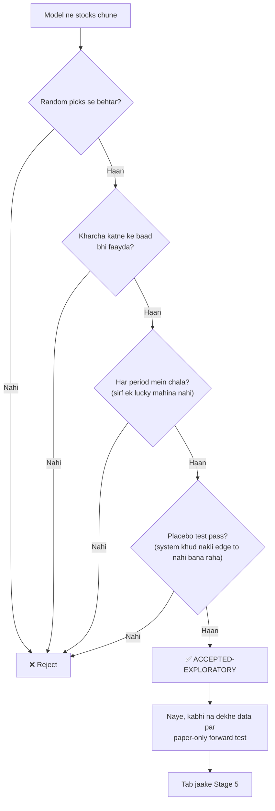
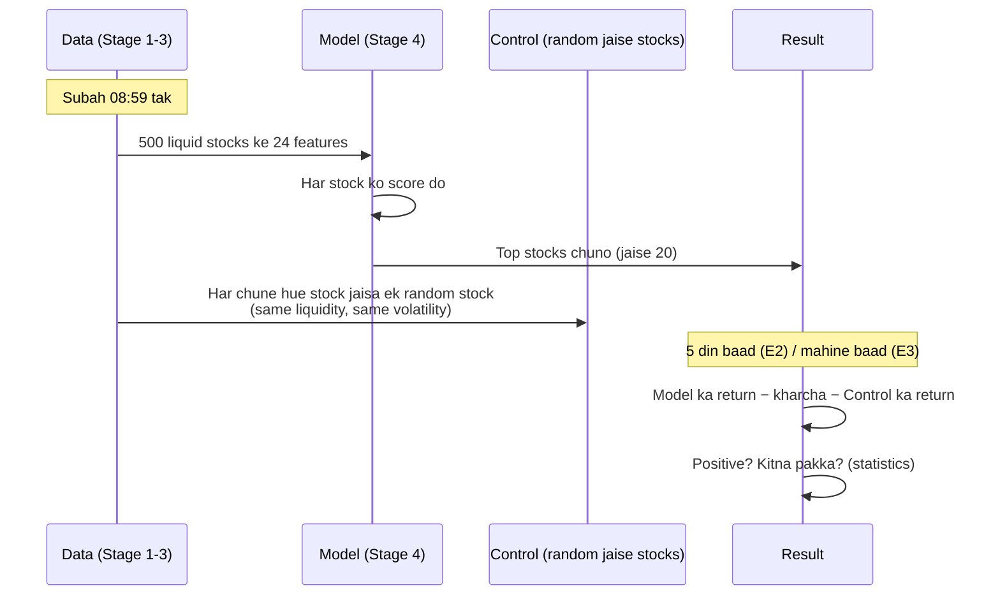
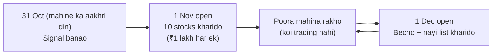
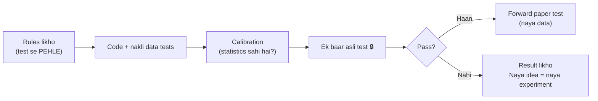
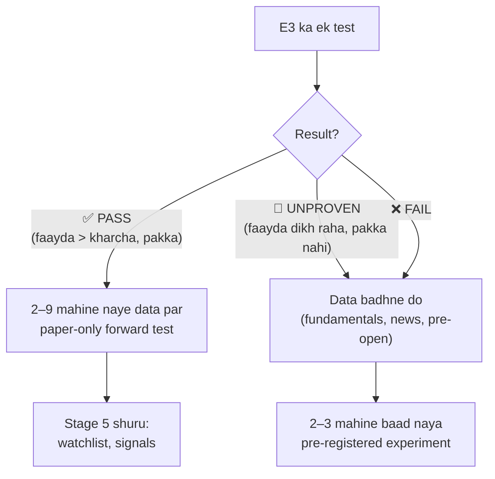

# Stage 4 ko aasaan bhasha mein samjho 🧠📈

> **Kiske liye:** jo bhi Prajna ka Stage 4 bina technical jargon ke samajhna chahta hai.
> **Kab tak ka status:** 15 Oct 2026.
> **Ek line mein:** Stage 4 woh "dimaag" hai jo roz subah batata hai ki kaunse stocks upar ja sakte hain. Lekin woh dimaag pehle **saboot** dega ki woh sach mein kaam karta hai, aur **kharche ke baad bhi** faayda deta hai.

---

## 1. Poori strategy mein Stage 4 kahan hai?

```mermaid
flowchart LR
    S1["Stage 1<br/>Data ikattha<br/>(prices, news, results)"] --> S2["Stage 2<br/>Data saaf<br/>(sahi time, no duplicate)"]
    S2 --> S3["Stage 3<br/>Features<br/>(104 signals)"]
    S3 --> S4["Stage 4<br/>Prediction Model<br/>(kaunsa stock upar jayega?)"]
    S4 --> S5["Stage 5<br/>Signal / Watchlist"]
    S5 --> S6["Stage 6<br/>Risk & Position size"]
    S6 --> S7["Stage 7<br/>Trade (abhi band)"]
    S7 --> S8["Stage 8<br/>Monitoring & seekhna"]

    style S1 fill:#cfe8ff
    style S2 fill:#cfe8ff
    style S3 fill:#cfe8ff
    style S4 fill:#ffd6e7,stroke:#c2185b,stroke-width:3px
    style S5 fill:#eeeeee
    style S6 fill:#eeeeee
    style S7 fill:#eeeeee
    style S8 fill:#eeeeee
```



| Rang | Matlab |
|---|---|
| 🔵 Neela | Ban chuka hai aur roz chal raha hai (Stage 1–3) |
| 🩷 Gulabi | **Yahan kaam chal raha hai** (Stage 4) |
| ⚪ Grey | Abhi shuru nahi hua, kyunki Stage 4 pass hone ka intezaar hai |

### Cricket wali misaal 🏏

| Stage | Cricket mein | Prajna mein |
|---|---|---|
| 1 | Har khiladi ka saara purana record ikattha karna | NSE ke har stock ka price, volume, news, results |
| 2 | Record saaf karna: galat entries hatana, sahi tareekh lagana | Duplicate hatana, sahi timestamp, koi "bhavishya ki jaankari" andar na aaye |
| 3 | Kaam ki baatein nikalna: "pichhle 5 match ka average", "form badh rahi hai?" | 104 features: RSI, momentum, volume spike, 20-din high ke paas? |
| **4** | **Selector: kal ke match ke liye kaun khelega?** | **Model: kal kaunse stock upar jayenge?** |
| 5–8 | Team banana, batting order, match khelna, review | Watchlist, risk, trade, monitoring |

---

## 2. Stage 4 sirf "predict" nahi karta, woh "saabit" karta hai

Koi bhi model kuch na kuch predict kar dega. Asli sawaal yeh hai:

> **"Kya yeh model ek bandar ke random picks se behtar hai, aur kya brokerage/tax katne ke baad bhi paisa bachta hai?"**



### Yeh "gates" kyun zaroori hain? Ek misaal

> **Scenario:** Ramesh bhai kehte hain "mera tip 10 mein se 7 baar sahi hota hai!"
> - Agar us mahine **poora market** upar gaya tha, to koi bhi random stock 7/10 baar upar jaata. Ramesh bhai ka tip special nahi tha. **Isliye hum random "control" stocks se compare karte hain.**
> - Agar har tip par ₹100 kamaye, lekin har trade par ₹150 brokerage aur tax diya, to aakhir mein **loss** hua. **Isliye hum kharcha katne ke baad dekhte hain.**
> - Agar sirf ek mahina achha gaya aur baaki 4 kharab, to woh **kismat** thi. **Isliye "har period mein chala?" check hota hai.**

---

## 3. Model kaam kaise karta hai? (roz ki kahani)



### Hamare 2 models (simple)

| Model | Kaise sochta hai | Misaal |
|---|---|---|
| **P1: Reversal** | "Jo kal zyada gira, woh aaj thoda wapas uthega" | TATA STEEL kal −4% gira, to aaj use upar rank karo |
| **P2: Ridge (simple ML)** | 24 features ko mila ke ek score banata hai (returns, RSI, MACD, volume…) | "RSI kam + volume spike + 20-din low ke paas", to score upar |

> **XGBoost, LSTM jaise bade models kyun nahi?** Jab simple model ka faayda kharche se kam hai, to bada model bas purane data ko "ratta" maar lega (overfitting). Naye data par woh fail hoga. Pehle signal mazboot chahiye, phir bada model.

---

## 4. Ab tak kya hua: 2 experiments

### 🧪 E1: "Subah kharido, shaam ko becho"

```
 09:15 open ──── kharido ────▶ 15:30 close ──── becho
         (roz 100 stocks, roz poora kharid-bech)
```

| Cheez | Number |
|---|---|
| Model ka faayda random se zyada | **~0.05–0.08% roz** (chhota, lekin real) |
| Kharcha, agar roz poori trading ho | isse kahin zyada |
| **Result** | ❌ **NOT ACCEPTED** (dono models) |

### 🧪 E2: "Kharido aur 5 din rakho"

Socha ki kam trading se kharcha kam hoga.

```
Din 1: Tranche A kharido ─────────────────────────▶ Din 6: becho
Din 2:   Tranche B kharido ─────────────────────────▶ Din 7: becho
Din 3:     Tranche C kharido ─────────────────────────▶ Din 8: becho
   ... (har din 1/5 hissa badalta hai)
```

| Cheez | P1 Reversal | P2 Ridge |
|---|---|---|
| Random se behtar? (gross) | ✅ +0.05% roz | ✅ +0.05% roz |
| Kya yeh luck tha? (permutation test) | Nahi, p = 0.005 | Nahi, p = 0.03 |
| Kharcha (₹10 lakh par) | ~0.19% roz | ~0.15% roz |
| **Kharche ke baad** | **−0.14% roz** | **−0.10% roz** |
| **Result** | ❌ UNPROVEN | ❌ UNPROVEN |

### 💡 Asli problem: dukaan wali misaal 🏪

> **Scenario:** Sonu ki chai ki dukaan hai.
> - Har cup par woh **₹5** kamata hai (yeh hai model ka "edge").
> - Lekin har baar dukaan kholne aur band karne ka **₹15** kharcha hai: bijli, safai, kiraya (yeh hai brokerage, STT, DP charge).
> - Agar Sonu din mein **20 baar** dukaan khole-band kare, to woh jitni zyada chai bechega utna zyada **loss** karega.
> - **Hal:** dukaan **ek baar** kholo aur poore din chalao. Matlab trade **kam karo**, lekin **bada** karo.

| Experiment | Model ka gross faayda (bps/din) | Kharcha (bps/din, ₹10 lakh) | Net | Source |
|---|---|---|---|---|
| E1, roz kharid-bech (100 stocks) | ~5–8 | ~100 (har din poora round-trip ₹10k orders par) | ❌ bahut negative | E1 result + cost table |
| E2 K20, 5-din (20 stocks) | ~5 | ~15–19 | ❌ −10 se −14 | **measured** |
| E2 K100, 5-din (100 stocks) | ~6 | ~52–66 | ❌ −46 se −59 | **measured** |
| **E3, mahina (10 stocks)** | **abhi pata nahi** (test baaki hai) | **~1–2** (andaza) | ? | design estimate |

> 📊 Jab tak **kharcha > faayda** hai, net loss hai. E3 mein kharcha pehli baar itna kam hai ki ek realistic faayda usse upar ja sake. **Lekin yeh test se hi pata chalega.**

### Kharcha itna zyada kyun? ₹10 lakh ka hisaab

```
₹10,00,000 ÷ 5 tranche ÷ 20 stocks = ₹10,000 ka ek order

₹10,000 ke order par:
  Brokerage    ₹20  ┐
  DP charge    ₹23.6┤ ye "flat" hai: order chhota ho ya bada, utna hi lagta hai
  STT 0.1%     ₹10  ┤ (dono taraf)
  Baaki tax    ~₹5  ┘
  ─────────────────
  Round trip ≈ 1% (100 bps)  ← bahut zyada!

₹1,00,000 ke order par wahi flat ₹43 sirf ~0.04% hai ← isliye bade orders sasta padte hain
```

---

## 5. Ab kya chal raha hai: 🧪 E3, "Mahine mein ek baar"

### Idea



### Kaunse stocks? (2 simple rules, koi tuning nahi)

| Predictor | Rule | Simple matlab |
|---|---|---|
| **P1: 12-1 Momentum** | Pichhle 12 mahine ka return, aakhri 1 mahina chhod ke | "Jo stock saal bhar se lagaatar badh raha hai, woh aage bhi thoda badhega." Aakhri mahina isliye chhodte hain kyunki short-term mein ulta (reversal) hota hai. |
| **P2: 52-week high ke paas** | Aaj ka price ÷ pichhle 52 hafte ka sabse uncha price | "Jo stock apne saal ke top ke paas hai, woh aksar wahan se aage nikalta hai." |

> **Example:**
> - Stock A: saal bhar mein +60%, aur abhi apne 52-week high ke 98% par hai. ✅ Dono rules mein upar.
> - Stock B: saal bhar mein −20%, aur high se 40% neeche hai. ❌ List mein nahi.

### Kharcha kitna girta hai?

| Design | Order size | Kharcha / din |
|---|---|---|
| E2 K20 (5-din, 20 stocks) | ₹10,000 | ~10–20 bps |
| **E3 (mahina, 10 stocks)** | **₹1,00,000** | **~1–2 bps** 🎉 |

> Matlab model ko ab sirf **~0.2–0.4% per mahina** se zyada kamaana hai, jabki pehle **~0.15% per din** chahiye tha.

### Data kitna hai?

```
2020 ───────────────────────────────────────────── 2026
 │◀── 12 mahine warm-up ──▶│◀──────── ~68 mahine ka TEST ────────▶│
 2020-01                 2021-01                               2026-08
```

- Daily price data **2020 se** hai (~1,685 trading din).
- Isse **~68 mahine** test karne ke liye milte hain. E2 mein sirf 100 din the.

### E3 ke steps

| Step | Kya | Status |
|---|---|---|
| 1 | Code + nakli (synthetic) data par tests | ✅ **Done** (17 tests pass) |
| 2 | Asli monthly data banana (production) | ⏸ Approval par |
| 3 | Statistics test ko 1,000 nakli duniyaon par check karna (calibration) | ⏸ |
| 4 | Ek hi baar asli test (no repeat) | ⏸ |
| 5 | Pass hua to naye mahino par paper-only forward test | ⏸ |

---

## 6. "Ek hi baar test" kyun? Exam wali misaal 📝

> **Scenario:** Agar student ko exam ka paper pehle dikha do, phir woh 10 baar exam de, to woh 100% laayega. Lekin asli zindagi mein fail hoga.
>
> Isliye hum:
> 1. Rules **pehle likh dete hain** (pre-registration),
> 2. Test **sirf ek baar** chalate hain (system doosri baar khud mana karta hai),
> 3. Fail hua to **rules dheele nahi karte**, naya idea alag experiment banta hai.



---

## 7. Data mein gadbad: aaj ka live example (15 Oct) 🔧

Stage 4 ka model tabhi sahi hoga jab data sahi ho. Aaj ek gadbad pakdi gayi:

> **Scenario: OLIL (OneClick Logistics) ka bonus share**
> - Company ne **1:2 bonus** diya: har 2 share par 1 free share. To share ka price **⅔** ho jaata hai (₹441 → ₹294).
> - Vendor ne purani history ko bhi ⅔ kar diya, lekin hamare paas bonus ka record nahi tha.
> - System ko laga **"price achanak 33% gir gaya, ye galat hai!"** aur usne **aaj ke features banana rok diya** (safety lock 🔒).
>
> **Kya kiya:**
> 1. Backup liya (4.6 GB).
> 2. Vendor se bonus ka record laaye: **BONUS 1:2, ex-date 15 Oct**.
> 3. Pata chala ki vendor price ko **0.6667 se multiply** karke round karta hai (1/1.5 ko 4 decimal tak). Hamara rule thoda alag tha. Rule ko vendor ke asli tareeke se mila diya, tests ke saath.
> 4. Data dobara laaye. Sab check pass hue, aur aaj ke features **dobara ban gaye** (427,386 rows; rerun karne par 0 duplicate).

> 💡 **Seekh:** agar yeh check na hota, to model sochta ki OLIL 33% gira aur use "sasta" maan ke kharid leta. Matlab **galat data, galat trade**. Isliye "No look-ahead, correct data" rule sabse upar hai.

---

## 8. Poora status ek nazar mein

```
Stage 1 Data        ██████████████████░░  ~85%  ✅ chal raha hai
Stage 2 Processing  ██████████████████░░  ~90%  ✅
Stage 3 Features    ███████████████░░░░░  ~75%  ✅
Stage 4 Prediction  ████████████████████  research ~100%  |  accepted model: 0% ❌
                    └─ E1 ❌, E2 ❌, E3 🔄 (step 1 done)
Stage 5 Signal      ░░░░░░░░░░░░░░░░░░░░   0%  ⛔ Stage 4 ka intezaar
Stage 6 Risk        ░░░░░░░░░░░░░░░░░░░░   0%  ⛔
Stage 7 Trade       ░░░░░░░░░░░░░░░░░░░░   0%  🔒 paper-only (jaan-boojh ke band)
Stage 8 Monitor     █░░░░░░░░░░░░░░░░░░░  ~5%
```
*(Percentages andaze hain.)*

---

## 9. Aage kya hoga? (3 scenarios)



| Scenario | Matlab | Aage |
|---|---|---|
| ✅ PASS | Model mahine mein kharche se zyada kamata hai, aur statistics pakka hai | Pehle naye mahino par **paper** test, phir Stage 5 |
| 🤷 UNPROVEN | Kuch faayda dikh raha hai, lekin itne data par pakka nahi | Aur data/time chahiye |
| ❌ FAIL | Kharche ke baad loss hai | Idea chhodo, naya idea try karo |

> **Imaandar baat:** koi bhi guarantee nahi de sakta ki model pass hoga. "Kharche ke baad koi faayda nahi" bhi ek **valid aur kaam ka result** hai, kyunki woh **asli paisa bachata** hai.

---

## 10. Yaad rakhne layak 5 baatein ✅

1. **Stage 4 = selector**, jo kal ke achhe stocks chunta hai, lekin **saboot ke saath**.
2. Model ka edge **real hai lekin chhota** (~0.05% roz). **Kharcha usse bada** hai.
3. Hal hai **kam aur bade trades**, isliye E3 mahine mein ek baar trade karta hai.
4. Test **ek hi baar**, rules **pehle se likhe**. Fail hone par bhi rules dheele nahi hote.
5. Sab kuch **paper-only** hai. Asli paisa tab tak nahi lagega jab tak aap khud permission na do. 🔒

---

*Related docs (technical):*
- `docs/STAGE4_E2_RESULTS.md`
- `docs/STAGE4_E3_DESIGN_DRAFT.md`
- `docs/STAGE4_COMPLETION_AUDIT.md`
- `docs/STAGE1_OLIL_B2_INVESTIGATION_2026-10-15.md`
